# COMP 3613 Assignment 2 Report

## Student information

| Field | Details |
|---|---|
| Student name | Eliana Dookhoo |
| Student ID | 816044896 |
| Project | MyAdvisor |
| Repository | [EllieD27/uwi-comp3613a1-my-advisor](https://github.com/EllieD27/uwi-comp3613a1-my-advisor) |
| Deployed application | [https://faststarter-ejhk.onrender.com](https://faststarter-ejhk.onrender.com) |

## 1. Project description

MyAdvisor is an academic planning application for students and advisors.
Students can view degree progress, build and submit semester plans, and review
feedback. An administrator/advisor can view submitted plans, approve a plan, or
request changes with a non-empty comment.

The minimum feature set is:

1. View Degree Progress (Student)
2. Build and Submit Semester Plan (Student)
3. Review and Submit Feedback (Advisor)

The deployed marker accounts are:

| Username | Password | Role | Use |
|---|---|---|---|
| `admin` | `adminpass` | Administrator/advisor | Review and feedback workflow |
| `bob` | `bobpass` | Student | Student workflows |
| `celeste` | `celestepass` | Student | Student workflows |
| `kate` | `katepass` | Student | Student workflows |
| `nelly` | `nellypass` | Student | Student workflows |
| `ian` | `ianpass` | Student | Student workflows |

## 2. Use-case diagram

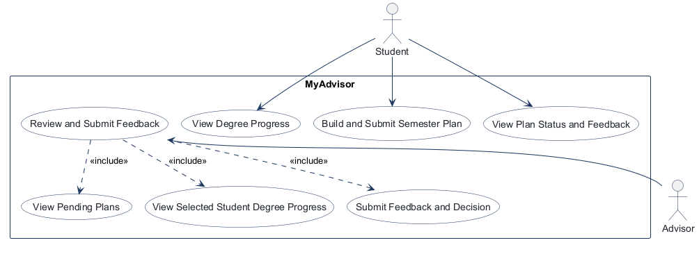

The editable source is [use-case.json](diagrams/use-case.json).

The advisor review workflow includes viewing pending plans, viewing the selected
student's degree progress, and submitting feedback and a decision. Login is a
precondition for protected student and advisor workflows.

## 3. Entity relationship diagram

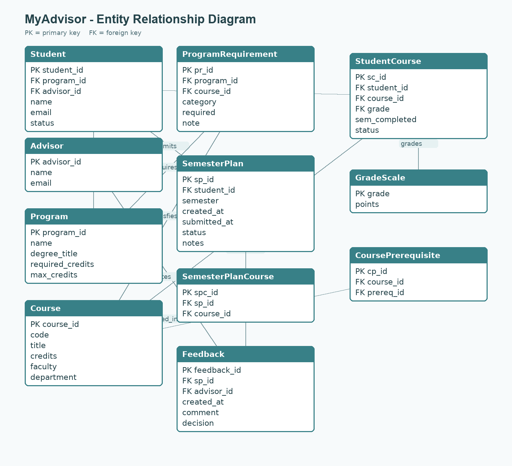

The editable model source is [model.mmd](diagrams/model.mmd).

The implemented model includes:

- `Student`, `Advisor`, and `Program`
- `Course`, `ProgramRequirement`, and `GradeScale`
- `SemesterPlan` and `SemesterPlanCourse`
- `StudentCourse` and `CoursePrerequisite`
- `Feedback`

Important rules include a unique `(sp_id, course_id)` plan-course pair,
credit-weighted GPA, prerequisite validation using completed C-or-better
courses, plan credit limits, and advisor ownership checks.

## 4. Wireframes

### Student dashboard — View Degree Progress

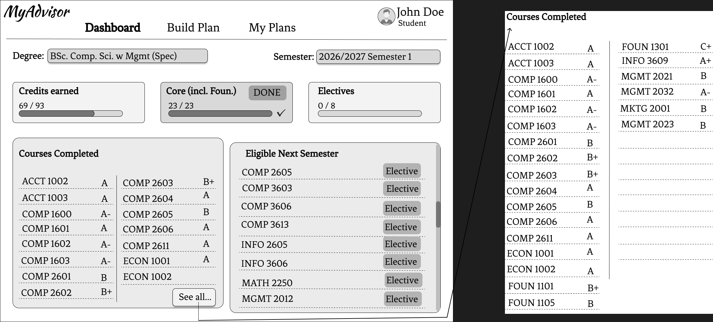

### Student Build Plan — Build and Submit Semester Plan

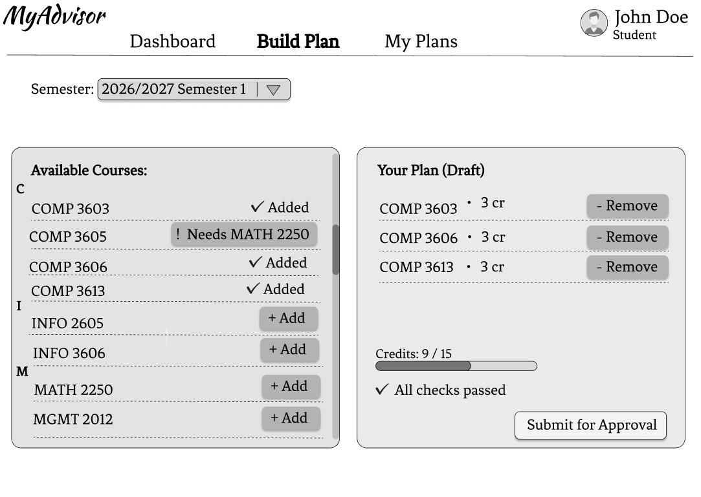

### Student My Plans — Review submitted plan and feedback

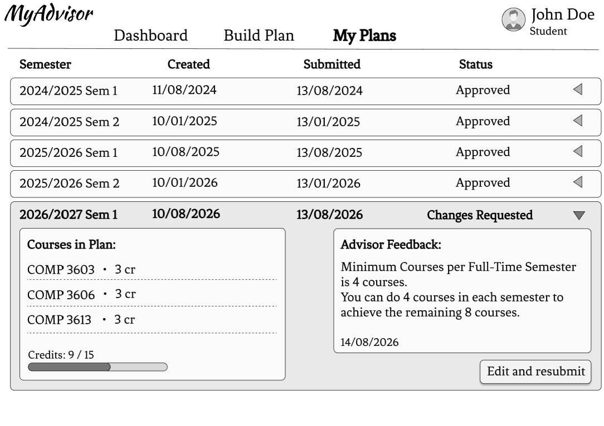

### Advisor Review Plans — Review and decide on a semester plan

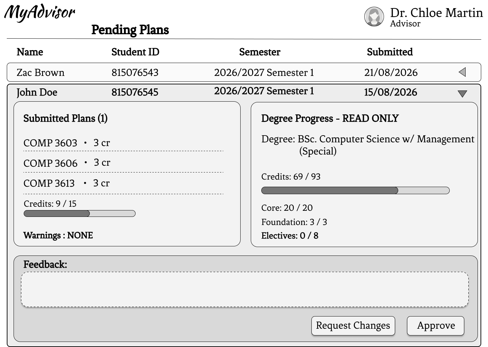

## 5. Test plans

The complete test-plan source is also retained in
[a2-test-plans.md](a2-test-plans.md).

### 5.1 Unit test plan

| Unit Test | Input | Expected Output |
|---|---|---|
| `test_academic_er_draft_models_exist_with_expected_keys` | Academic model classes | All required ERD fields exist on the model classes |
| `test_semester_plan_course_prevents_duplicate_course_entries` | A `SemesterPlanCourse` table definition | A unique constraint exists for `sp_id` and `course_id` |
| `test_feedback_decision_is_restricted_to_erd_values` | The `Feedback` table definition | The decision constraint allows `Approve` and `Request changes` |
| `test_passed_course_ids_requires_completed_c_or_better` | Student course records with C, B, F, and in-progress grades | Only completed courses with C-or-better grades are returned |
| `test_dashboard_credit_and_course_count_cards_reconcile_to_93_credits` | A student with completed core courses | Earned credits and core/elective counts match the degree requirements |
| `test_gpa_is_credit_weighted_and_ignores_ungraded_courses` | Completed A and B courses plus an ungraded in-progress course | GPA is calculated as a credit-weighted 3.5 and ignores the ungraded course |
| `test_build_plan_service_marks_prerequisite_gap_and_selected_courses` | Student plan, catalog courses, and prerequisite data | Selected courses, credits, course statuses, and prerequisite checks are correct |
| `test_build_plan_catalog_is_bob_completed_and_planned_courses_in_code_order` | The semester-plan catalog | The catalog contains the expected courses in code order |
| `test_completed_course_is_marked_and_cannot_be_added_again` | A completed course submitted for addition | The course is marked completed and is not added to the plan |
| `test_semester_plan_service_add_and_submit_update_plan_state` | A valid course addition followed by plan submission | The course is added and the plan status changes to `Submitted` |
| `test_add_course_rejects_plan_that_would_exceed_credit_limit` | A plan at the maximum credit limit | The additional course is rejected and no database object is added |
| `test_add_course_rejects_course_when_prerequisite_is_not_passed` | A course whose prerequisite is not passed | The course is rejected and no database object is added |
| `test_my_plans_view_includes_erd_related_courses_and_feedback` | A submitted plan with courses and advisor feedback | The view contains the plan, courses, credits, and feedback |
| `test_my_plans_view_is_empty_for_user_without_student_record` | A user with no student record | The service returns an empty plans view |
| `test_admin_dashboard_includes_assigned_pending_plan_and_gpa` | An advisor with an assigned submitted plan | The dashboard includes the plan, student, courses, credits, progress, and GPA |
| `test_submit_plan_decision_saves_feedback_and_updates_plan_status` | A valid advisor decision and comment | Feedback is saved and the plan status is updated |
| `test_submit_plan_decision_rejects_unassigned_or_invalid_decisions` | An invalid decision or an unassigned advisor | No feedback or plan update is saved |
| `test_request_changes_requires_a_comment` | `Request changes` with an empty comment | The decision is rejected and the plan remains submitted |
| `test_advisor_review_template_contains_wireframe_details_and_gpa` | Advisor review template source | Required review controls, plan details, and GPA labels are present |
| `test_build_plan_course_options_are_scrollable` | Build-plan template source | Course options have the required scrollable layout |

The consolidated implementation is
[tests/test_unit.py](../tests/test_unit.py).

### 5.2 Integration test plan

| Test | Dependencies | Description |
|---|---|---|
| `test_health` | Test client, health route | Calls `GET /health` and verifies the application health endpoint returns HTTP 200 |
| `test_public_landing_page_is_available` | Test client, in-memory database, landing route | With the isolated test database and no login, verifies that the public landing page returns HTTP 200 and displays MyAdvisor |
| `test_student_dashboard_requires_login` | Test client, login route, authentication dependency | With no authentication cookie, verifies that the student dashboard redirects to the login page |
| `test_authenticated_student_can_view_dashboard` | Test client, login route, seeded student, in-memory database | Logs in as the seeded student and verifies that the student dashboard returns HTTP 200 with degree-progress content |
| `test_regular_user_cannot_view_admin_dashboard` | Test client, login route, seeded student, admin dependency | Logs in as a regular student and verifies that access to the admin dashboard returns HTTP 401 |
| `test_admin_can_view_admin_dashboard` | Test client, login route, seeded admin, in-memory database | Logs in as the seeded admin and verifies that the admin dashboard returns HTTP 200 |
| `test_users_api_returns_user_response_shape` | Test client, login route, admin dependency, user repository | Verifies unauthenticated `GET /api/users` is rejected, then verifies an authenticated admin receives only the `id`/`username`/`email` response fields |
| `test_student_can_add_and_submit_a_semester_plan` | Test client, login route, plan service, in-memory database | Logs in as a student, adds `COMP 3603`, submits the plan, and verifies the database status is `Submitted` |
| `test_admin_can_decide_on_submitted_semester_plan` | Test client, login route, plan service, advisor review service, in-memory database | Creates a submitted student plan, logs in as admin, approves it, and verifies the plan status and feedback record |
| `test_student_cannot_post_an_advisor_decision` | Test client, student login, admin dependency, advisor review service | A student attempts to approve a submitted plan and the test verifies authorization failure, unchanged plan status, and no feedback |
| `test_request_changes_without_a_comment_is_rejected` | Test client, admin login, advisor review service, feedback validation | An admin submits `Request changes` with an empty comment and the test verifies the plan remains `Submitted` with no feedback |
| `test_course_with_unmet_prerequisite_cannot_be_added` | Test client, student login, plan service, prerequisite data | A student attempts to add `COMP 3605` without its prerequisite and the test verifies no plan-course row is created |
| `test_advisor_cannot_decide_on_another_advisors_student` | Test client, admin login, advisor assignment data, advisor review service | An admin attempts to decide on a plan assigned to another advisor and the test verifies the plan remains `Submitted` with no feedback |

The repository-focused unit test is an exception to the usual isolated unit
boundary: it uses an in-memory SQLite database. The two template-source unit
tests are also exceptions because they read template files. The remaining
unit tests use mocked or in-memory service inputs without the application test
client.

All integration tests use the isolated in-memory SQLite fixture in
[tests/conftest.py](../tests/conftest.py); they do not modify the development
database. The implementation is in
[tests/test_integration.py](../tests/test_integration.py).

### 5.3 User acceptance test report

**Tester Name:** Eliana Dookhoo  
**Tester Position:** Software Engineering 2 Student  
**Date of Test:** 10 / 11 / 2026

| Test Case | Pre-conditions | Test Steps | Test Criteria | Success (indicate with a check) |
|---|---|---|---|---|
| View Degree Progress | The student account exists and the tester is logged in as a student. | 1. Open the student dashboard; 2. Review the degree-progress cards. | The dashboard shows earned credits, required credits, core/elective course counts, and GPA. | ☑ Pass / ☐ Fail |
| Build and Submit Semester Plan | The tester is logged in as a student and the course catalogue is available. | 1. Open **Build Plan**; 2. Select a valid course; 3. Add the course to the plan; 4. Submit the plan. | The selected course and total credits are displayed, the submission completes, and the plan status becomes `Submitted`. | ☑ Pass / ☐ Fail |
| Review and Approve Semester Plan | A student plan is submitted and the tester is logged in as the assigned advisor/admin. | 1. Open the advisor dashboard; 2. Review the submitted plan; 3. Enter feedback; 4. Select **Approve**. | The plan is removed from the pending queue, the plan status becomes `Approved`, and the feedback is saved. | ☑ Pass / ☐ Fail |
| Request Changes to a Semester Plan | A student plan is submitted and the tester is logged in as the assigned advisor/admin. | 1. Open the submitted plan; 2. Enter a non-empty feedback comment; 3. Select **Request Changes**. | The plan status becomes `Request Changes` and the feedback is available for the student to review. | ☑ Pass / ☐ Fail |
| Prevent Invalid Plan Actions | The tester is logged in as a student and selects a course whose prerequisite has not been passed. | 1. Open **Build Plan**; 2. Attempt to add the course with the unmet prerequisite. | The course is not added, the plan remains unchanged, and the course status explains that a prerequisite is required. | ☑ Pass / ☐ Fail |

**Acceptance Decision:** ☑ Accepted / ☐ Rejected

**Signature:** Eliana Dookhoo

## 6. Implementation

### 6.1 Repository and architecture

Repository:
[EllieD27/uwi-comp3613a1-my-advisor](https://github.com/EllieD27/uwi-comp3613a1-my-advisor)

The application uses FastAPI and SQLModel with the layered architecture:

```text
Routes → Dependencies → Schemas → Services → Repositories → Models
```

Routes bind request data and call services. Repositories contain persistence
operations, while services contain application rules such as prerequisite
validation, credit limits, plan status changes, and advisor ownership.

### 6.2 Feature implementation

| Req Num | Feature | Controller / Route | Description |
|---:|---|---|---|
| 0 | Authentication and authorization | `app/routers/login.py`, `AuthDep`, `AdminDep` | Authenticates users, preserves safe redirects, routes students to `/app`, routes admins to `/admin`, and protects role-specific pages. |
| 1 | View degree progress | `app/routers/user_home.py`, `DegreeProgressService` | Displays earned credits, required credits, course counts, prerequisites, and credit-weighted GPA for the signed-in student. |
| 2 | Build and submit semester plan | `app/routers/user_home.py`, `SemesterPlanService` | Creates or loads a student plan, validates course selection and prerequisites, enforces credit limits, and submits the plan. |
| 3 | Review and approve semester plan | `app/routers/admin_home.py`, `AdvisorReviewService` | Allows the assigned advisor/admin to review a submitted plan and approve it with feedback. |
| 4 | Request changes | `app/routers/admin_home.py`, `AdvisorReviewService` | Requires a non-empty comment, records feedback, and changes the plan status to `Request changes`. |
| 5 | Prevent invalid plan actions | `SemesterPlanService`, `AdvisorReviewService` | Rejects duplicate courses, completed courses, unmet prerequisites, excessive credits, unauthorized decisions, and blank change requests. |

### 6.3 Authorization

- Student routes use the authenticated-user dependency.
- Admin routes use the admin dependency.
- Unauthenticated student dashboard access redirects to `/login`.
- Unauthenticated admin access returns HTTP 401.
- Non-admin users cannot submit advisor decisions.
- Advisors cannot decide on plans belonging to another advisor's student.

### 6.4 REST/API implementation

The collection tests these endpoints:

| Method | Endpoint | Purpose |
|---|---|---|
| GET | `/health` | Health check |
| GET | `/` | Public landing page |
| GET | `/api/users` | Admin-only user response-shape test |
| GET | `/app` | Protected student dashboard |
| GET | `/app/build-plan` | Authenticated student course-planning page |
| POST | `/app/build-plan` | Authenticated student add/remove/submit plan actions |
| GET | `/app/my-plans` | Authenticated student submitted-plan history |
| GET | `/admin` | Protected administrator dashboard |
| POST | `/admin/plans/{id}/decision` | Authenticated advisor approval or change request |
| POST | `/login` | Role-based login routing |

**Limitations.** The workflow endpoints use the existing server-rendered form
routes rather than a separate JSON API. They still follow resource-oriented
paths and return redirects after successful form mutations. The Postman
collection authenticates a student and an administrator, exercises the
student plan workflow, and submits an administrator decision. A future API
revision could add JSON representations without changing these workflow
services.

### 6.5 API specification

| Description | Method | URL | Request / Headers | Response / Status |
|---|---|---|---|---|
| Health check | GET | `/health` | None | `{"ok": true}` / 200 |
| Public landing page | GET | `/` | None | Landing page HTML / 200 |
| Admin users response | GET | `/api/users` | Authenticated admin session cookie | User fields as an array / 200; unauthenticated or non-admin access is rejected |
| Student dashboard | GET | `/app` | Authenticated session cookie | Dashboard HTML / 200; unauthenticated access redirects to `/login` / 303 |
| Build-plan page | GET | Authenticated student session cookie | Student build-plan HTML / 200 |
| Add course | POST | `/app/build-plan` | Authenticated student cookie; form `action=add&course_code=COMP 3603` | Redirect to `/app/build-plan` / 303; valid course is added |
| Submit plan | POST | `/app/build-plan` | Authenticated student cookie; form `action=submit` | Redirect to `/app/build-plan` / 303; plan status becomes `Submitted` |
| My plans | GET | Authenticated student session cookie | Student plan history HTML / 200 |
| Admin dashboard | GET | `/admin` | Authenticated admin session cookie | Dashboard HTML / 200; unauthenticated or non-admin access / 401 |
| Plan decision | POST | `/admin/plans/{id}/decision` | Authenticated admin cookie; form `decision=Approve` and `comment=...` | Redirect to `/admin` / 303; plan status becomes `Approved` |
| Login | POST | `/login` | Form username and password | Role-based redirect to `/app` or `/admin` / 303; invalid credentials return the login page with an error |

## 7. Unit-test implementation

Existing unit tests were retained and expanded for Assignment 2. The consolidated unit-test module is:

- [test_unit.py](../tests/test_unit.py)

Run the unit tests with:

```powershell
.\.venv\Scripts\python.exe -m pytest tests\test_unit.py -v --color=yes
```

## 8. Integration-test implementation

Run the integration tests with:

```powershell
.\.venv\Scripts\python.exe -m pytest tests\test_integration.py -v --color=yes
```

The fixture in [tests/conftest.py](../tests/conftest.py) creates an isolated
database, seeds separate student and admin identities, and overrides the
application session dependency so the development database is not modified.

## 9. Postman collection

The exported Postman v2.1 collection is:

[MyAdvisor-Assignment-2-API-Tests.postman_collection.json](../postman/MyAdvisor-Assignment-2-API-Tests.postman_collection.json)

Collection name:

```text
MyAdvisor Assignment 2 API Tests
```

The collection contains:

- Health and public endpoint tests
- Admin-only users API response-shape and refusal tests
- Unauthenticated student and admin authorization tests
- Admin login routing test
- Student login routing test
- Authenticated student plan-page, add-course, submit-plan, and my-plans requests
- Authenticated admin plan-decision request

The `baseUrl` collection variable defaults to:

```text
http://127.0.0.1:5000
```

For the deployed application, change it to:

```text
https://faststarter-ejhk.onrender.com
```

The authorization requests disable redirects and isolate the cookie state so
consecutive collection runs do not reuse a successful login session.

## 10. Test-report evidence

The Postman collection was run locally with one iteration. The run completed
with 23 passing tests, 0 failures, 0 skipped tests, and 0 errors.

### Unit-test screenshot

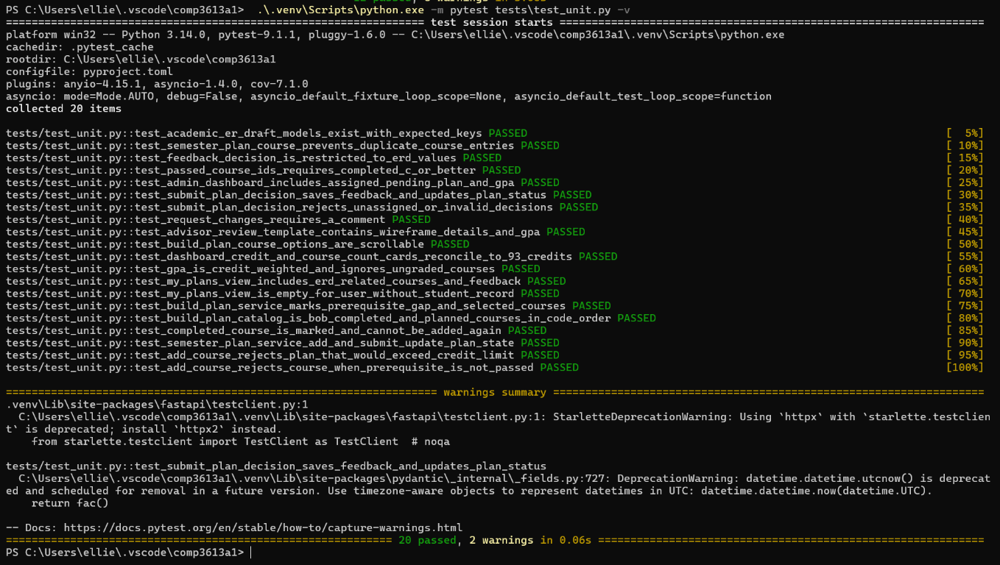

### Integration-test screenshot

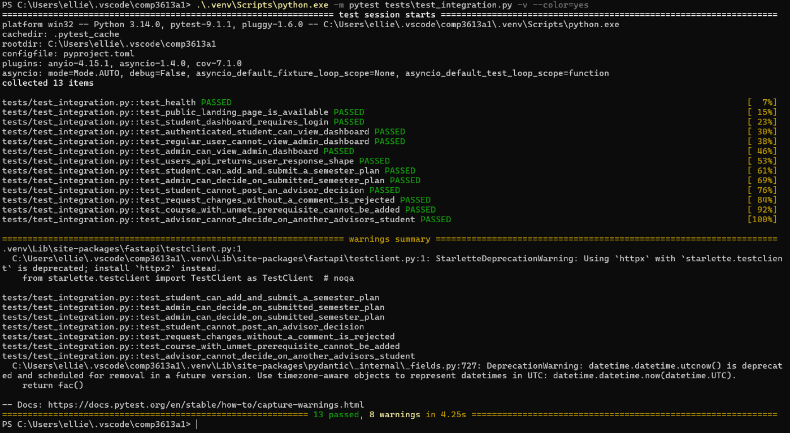

### Postman collection screenshot

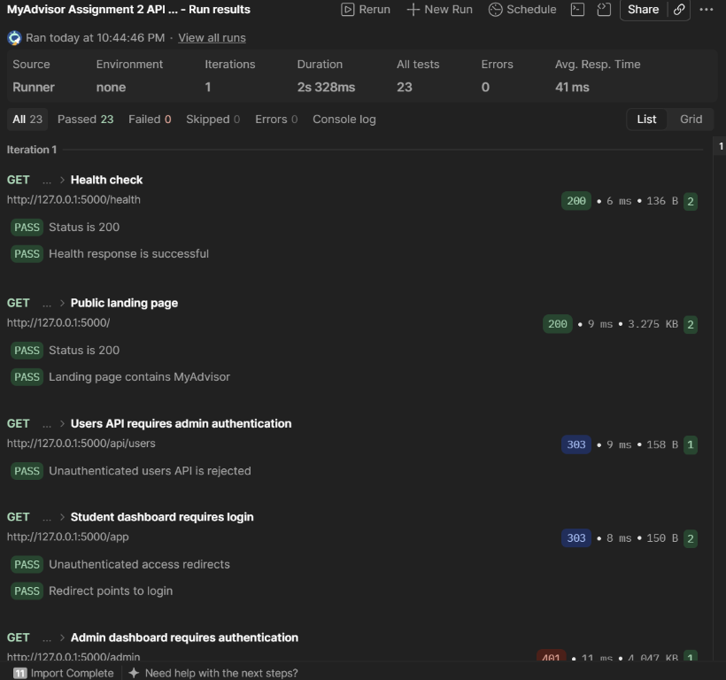

### Postman authorization and workflow requests

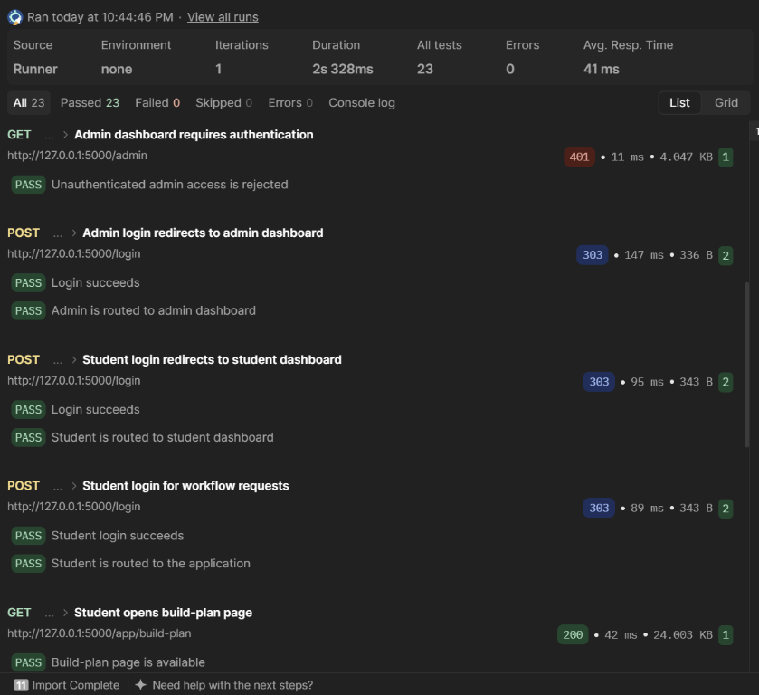

### Postman student workflow requests

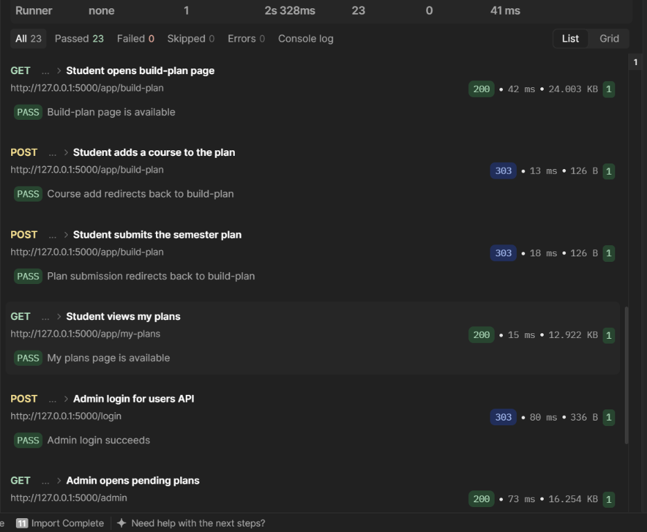

### Postman administrator workflow requests

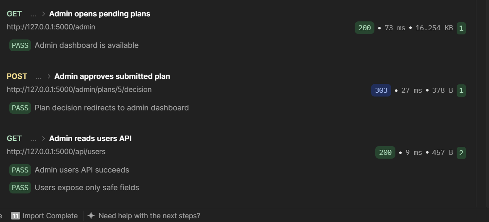

## 11. UAT evidence

The completed UAT form is included in
[a2-test-plans.md](a2-test-plans.md), including the five passing cases,
tester details, accepted decision, and signature.
