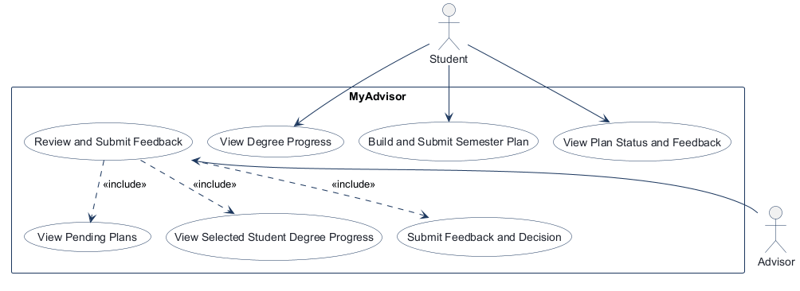
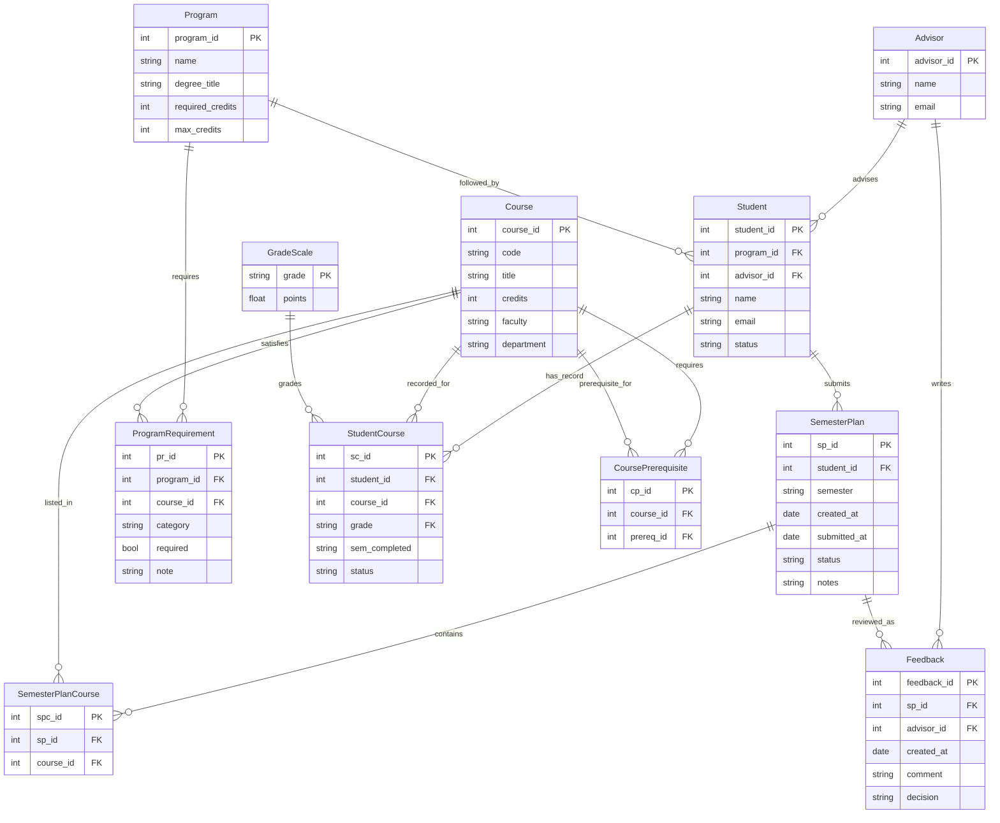
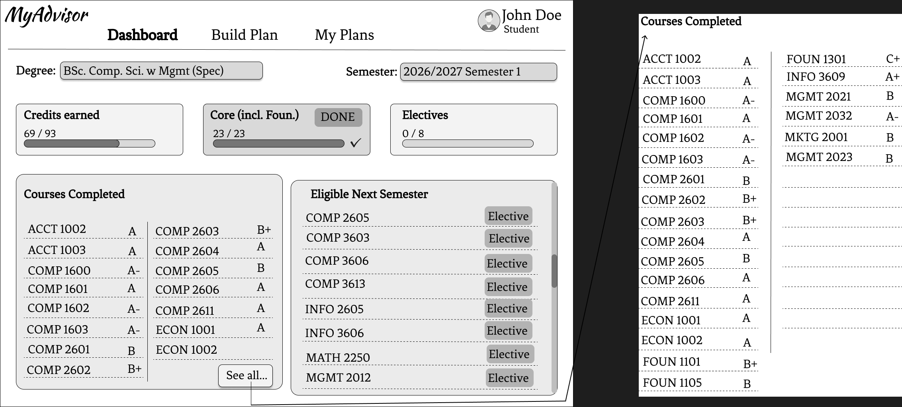
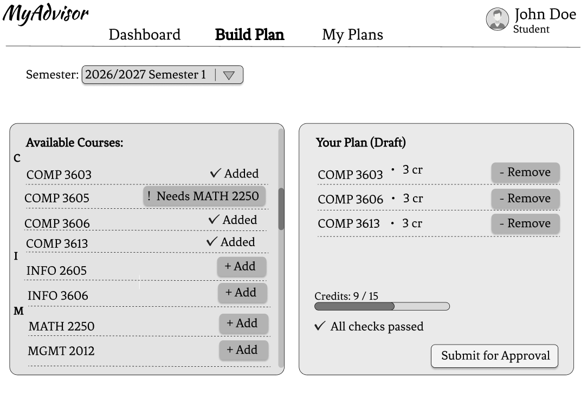
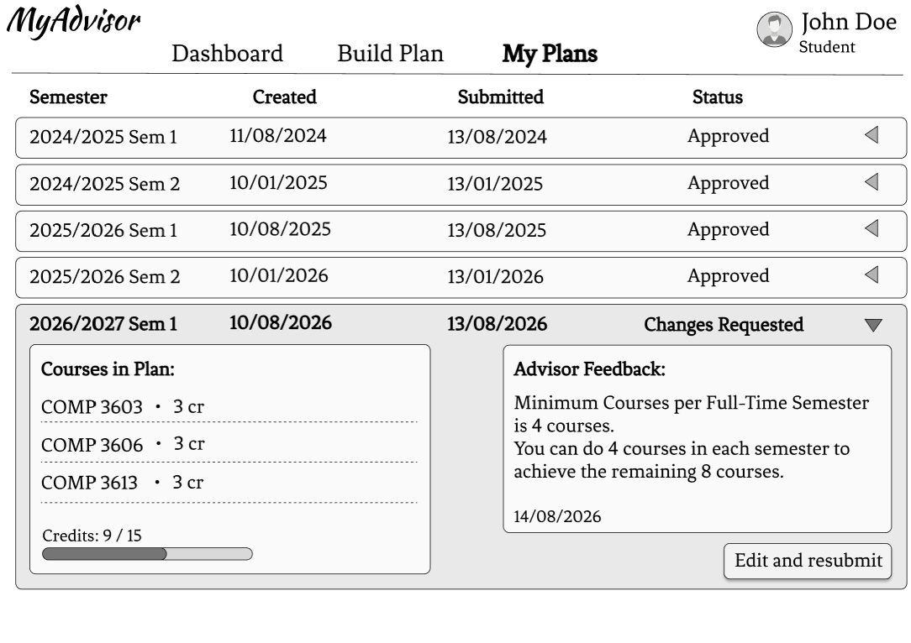
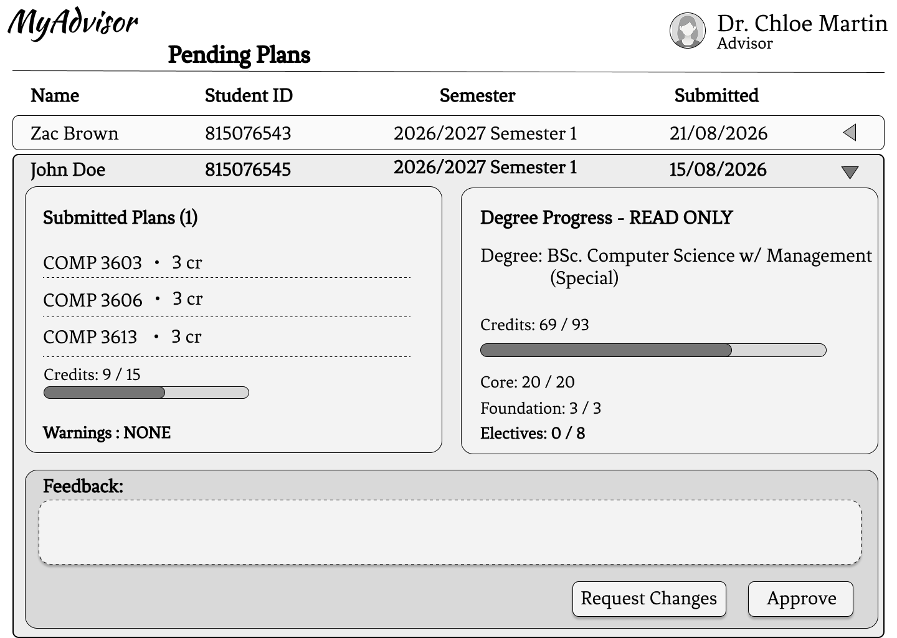

# COMP 3613 Assignment 1

Draft this file with the Guide. **Update it after every phase milestone** before you pause. The use-case diagram is a UML PNG at `docs/diagrams/use-case.png`, linked from this file as `diagrams/use-case.png` (path relative to `docs/report.md`). The model diagram is Mermaid. **Embed wireframe images** as `wireframes/<file>` (files live in `docs/wireframes/`).

Do not put your student ID in this file if you will commit it. The PDF cover adds your name and ID at export time.

## Assigned project

MyAdvisor

## Three workflows

### 1. View Degree Progress (Student)

### 2. Build and Submit Semester Plan (Student)

### 3. Review and Submit Feedback (Advisor)

## Use case diagram

### Phase 2 notes

- **Build and Submit Semester Plan** is independent of **View Degree Progress**; viewing progress is not a required sub-step.
- Students view their own degree progress and can view the status and feedback outcome for their plans.
- **Review and Submit Feedback** includes **View Pending Plans**, **View Selected Student Degree Progress**, and **Submit Feedback and Decision**; feedback and a decision are part of the advisor's review flow.
- Login is a precondition implied by the Student and Advisor actors, not a use case.

## Model diagram

First draft. Update this section in Phase 5 when polish revises the model, and note what changed.

### Phase 3 notes

- A `Student` follows one `Program` and is assigned one `Advisor`; an advisor can advise many students. The advisor's pending-plan queue is limited to plans belonging to their assigned students.
- `StudentCourse` records a student's course outcome, including grade, completion semester, and status. These records support both degree-progress calculations and prerequisite validation.
- `CoursePrerequisite` is a self-referential course association: a course can list multiple prerequisite courses, and passing any one listed prerequisite is sufficient for eligibility.
- A prerequisite counts as passed only when its `StudentCourse` status is completed and its `GradeScale.points` value is at least the points assigned to C.
- Each `SemesterPlan` represents one semester, so `semester` is stored on the plan and shared by all its `SemesterPlanCourse` entries. `SemesterPlanCourse` only links selected courses to a plan; course approval and priority are not tracked individually because review feedback applies to the plan overall.
- `SemesterPlanCourse` has a unique `(sp_id, course_id)` pair so one course cannot be added twice to the same plan; the same course may still appear in different semester plans.
- `ProgramRequirement` links the program requirements to courses and supports degree-progress checks.
- `Feedback` belongs to a reviewed semester plan and is written by an advisor; the student is derived through the plan, and `decision` records the advisor's overall outcome.
- `Program.max_credits` sets the maximum credits allowed in a student's semester plan.
- `SemesterPlan.status` is `Draft`, `Submitted`, `Approved`, or `Request Changes`.
- `Feedback.decision` is `Approve` or `Request changes`.
- Advisor review queue shows only `Submitted` plans for students assigned to the signed-in advisor, ordered oldest submission first; drafts and already-decided plans are excluded. The expanded review uses the existing plan/student/course/feedback entities and displays read-only degree progress including calculated GPA; no GPA column is stored.
- `StudentCourse.status` is `Completed` or `In progress`.
- Phase 5 GPA addition: `GradeScale` stores each UWI letter grade and quality-point value; `StudentCourse.grade` references `GradeScale.grade`. Dashboard GPA is credit-weighted and shows `N/A` when the student has no completed grade records.
- Phase 5 credit update: every catalog course is three credits. Degree progress and GPA use the course credit values, while semester-plan capacity uses `Program.max_credits` and rejects additions that would exceed it.

## Wireframes

Phase 4 review: the student-crafted wireframes cover the three named workflows for MyAdvisor and match the model decisions from earlier phases.

### Student Dashboard

### Build Semester Plan

### Student My Plans

### Advisor Review Plans

`python manage.py report` also embeds any PNG/JPG still missing from `docs/wireframes/`.

## Theming

- Theme direction: Squilla Fund.
- Color system: teal blue (#388087), moonstone blue (#6FB3B8), powder blue (#BADFE7), Magic Mint (#C2EDCE), and White Smoke (#F6F6F2). Warning messages use a light-red background with dark-red text for clear distinction.
- Typography: the MyAdvisor wordmark uses Kaushan Script, a bold slanted brush script chosen to closely match the student wireframe; Fraunces display headings and Source Sans 3 body text remain for the rest of the interface.
- Applied across the landing, login, register, dashboard, Build Plan, My Plans, authenticated shell, session-expired page, admin shell, and server config page. Shared Bootstrap controls, tables, and alerts use the same palette; warnings/errors have a light-red background and dark-red text. The MyAdvisor wordmark remains in Kaushan Script.

## Implementation notes

- The student dashboard was restyled toward the wireframe’s horizontal header, degree/semester context row, three progress blocks (Credits earned, Core (incl. Foundation), Electives), and paired course panels. The overall degree card and GPA use course-credit weighting; Core and Electives cards count required courses from `ProgramRequirement` categories.
- Demo academic seed data uses 31 catalog courses at three credits each, for a 93-credit degree requirement. Requirements are 23 Core courses (including Foundation) and 8 Elective courses. Bob's 23 completed Core courses yield 69 / 93 credits earned and 23 / 23 Core (incl. Foundation); Electives are 0 / 8 courses.
- Replaced the dashboard's Semester Plan Snapshot with the wireframe's Eligible Next Semester panel. The listed choices come from the wireframe's course set and are filtered by prerequisite completion; COMP 2605 is excluded because it is already completed.
- Updated catalog display names: ACCT 1002 — Introduction to Financial Accounting; ACCT 1003 — Introduction to Cost and Management Accounting; COMP 1600 — Introduction to Computing Concepts; COMP 1601 — Computer Programming I; COMP 1602 — Computer Programming II.
- Updated catalog display names: COMP 1603 — Computer Programming III; COMP 2601 — Computer Architecture; COMP 2602 — Computer Networks; COMP 2603 — Object-Oriented Programming; COMP 2604 — Operating Systems.
- Updated catalog display names: COMP 2605 — Enterprise Database Systems; COMP 2606 — Software Engineering I; COMP 2611 — Data Structures; ECON 1001 — Introduction to Microeconomics; ECON 1002 — Introduction to Macroeconomics.
- Updated catalog display names: FOUN 1101 — Caribbean Civilisation; FOUN 1105 — Scientific and Technical Writing; FOUN 1301 — Law, Governance, Economy and Society; INFO 3609 — Internship I; MKTG 2001 — Principles of Marketing (replacing the incorrect MGMT 2001 code).
- Updated catalog display names: MGMT 2021 — Business Law I; MGMT 2008 — Organizational Behaviour; MGMT 2032 — Managerial Economics; MGMT 2012 — Quantitative Methods (replacing MGMT 2023); COMP 3603 — Human-Computer Interaction; COMP 3606 — Wireless and Mobile Computing; COMP 3613 — Software Engineering II.
- Added prerequisites: COMP 1602 requires COMP 1601; COMP 2611 requires COMP 1602; COMP 2605 requires COMP 1601; COMP 3606 requires COMP 2602; COMP 3613 requires COMP 2606. COMP 3605 retains its MATH 2250 prerequisite. Prerequisite checks require a completed C-or-better grade from `GradeScale`.
- Build Plan options now use the 26-course union of Bob's seeded completed-course list and his three originally planned courses. The options are grouped and alphabetized by course code in a bounded, independently scrollable list matching the wireframe; courses completed by the signed-in student show Completed and cannot be added again.
- Build Plan typography was reduced to match the dashboard scale: 1.1rem navigation, 1.25rem panel headings, and approximately 1rem course, summary, and action text.
- Final seeded roster is five students total including Bob: Bob, Ian McCarthy, Celeste Weston, Kate Baxter, and Nelly miller. The seed command and targeted `purge-demo-students` command remove Lee Benjamin, Rupert Welch, and Bridget Harvey with their associated student records, plans, plan-course rows, transcripts, feedback, and user accounts. Ian has no completed courses and displays all unfinished Year 1 courses as eligible next-semester options. Celeste and Nelly each have five completed Year 1 courses; their remaining Year 1 courses appear as eligible options. Kate has completed all ten listed Year 1 courses and has five Year 2 courses in her next-semester plan. Ian and Celeste have five year-one courses in their plans; Nelly has five year-two courses. There is no seeded year-three student after Rupert's removal. Each planned course is three credits.
- Kate's eligible-next-semester fallback now lists every catalog course whose numeric code is in the 2000s, and the eligible-course panels use a consistent vertical scrollbar for every student.
- Eligible Year 1 and Year 2 recommendations are both labeled `Core`, matching the program's course classification.
- Eligible course recommendations exclude any course already recorded as completed for the signed-in student, including Bob's completed 2000-level core courses.
- Students who have completed the full core sequence also receive the remaining advanced eligible courses, including COMP 3603, COMP 3606, and COMP 3613, subject to prerequisite checks.
- The advanced eligible set explicitly includes MGMT 2012; selecting that set depends only on completing the ten defined Year 1 courses, not on a separate requirement-count calculation.
- Build Plan now includes MGMT 2012 in its available catalog, so students can add it to a semester plan when it is not already completed and the plan has capacity.
- INFO 2605, MATH 2250, and MGMT 2012 are classified as Electives across the application; Year 1 and the remaining Year 2 course codes remain Core, while advanced elective recommendations display Elective.
- Student visual verification of this dashboard polish is pending.
- The student My Plans view uses the existing `SemesterPlan`, `SemesterPlanCourse`, `Course`, and `Feedback` entities. A thin authenticated route delegates to the plan service; repository queries return only the signed-in student's plans, with courses, credit totals, and feedback presented in a wireframe-style table with expandable details. Verification against the wireframe is pending.
- Advisor review dashboard follows the advisor wireframe's Pending Plans list and expanded read-only student progress, including GPA, planned courses, and feedback context. The queue is scoped to students assigned to the Advisor record linked to the signed-in admin. Verification against the wireframe is pending.
- Advisor list behavior: show only Submitted plans belonging to assigned students, oldest submission first; exclude drafts and decided plans. The expanded view shows the existing degree progress summaries and calculated GPA, with Plan Courses on the left and Feedback and Decision on the right, matching the wireframe. Completed transcript rows are not repeated in the advisor detail view. Decisions use `Feedback` and transition `SemesterPlan.status` to `Approved` or `Request Changes`.
- Advisor demo login is admin / adminpass. The seed data marks Nelly's year-two plan as Submitted for review; other new demo plans remain Draft.
- Student code-check evidence: the admin route constructs the repository/service and delegates to `get_admin_dashboard_view`; no query logic was placed in the router. The initial duplicate `Literal` field attempt was reconciled into one `Feedback.decision` field and a named SQL `CheckConstraint`, preserving the exact ERD decisions while keeping the SQLModel field type portable. Automated advisor service/template/model tests pass; visual workflow verification is pending.
- Dashboard progress correction: Core (incl. Foundation) and Electives display course counts (23 and 8 requirements), while Credits earned remains credit-based (69 / 93 for Bob). The catalog has 31 three-credit courses; the current database's ProgramRequirement rows were refreshed with `sync-degree-requirements` without resetting student plans or transcripts.

## Deployed app

Phase 6. Public Render URL (not localhost). Markers open this to mark the three workflows.

https://

## Logins

Every account a marker needs, including extra users you added. Starter accounts:

- bob / bobpass — regular user
- ian / ianpass — regular user
- celeste / celestepass — regular user
- kate / katepass — regular user
- nelly / nellypass — regular user
- admin / adminpass — admin

## YouTube URL

## Session transcripts

Filled when the Guide builds the report: the agent writes each Guide chat to `docs/transcripts/<slug>.md` (Copilot Agent, Cursor, or OpenCode). `python manage.py report` packages them. Do not paste chats here during the build.

## Competency (student-judge)

Filled when the report is built. Guide runs student-judge, writes `docs/judge.md`, and export appends the scorecard here.

## Skill integrity

Filled by `python manage.py report`. Do not edit the course skills.
